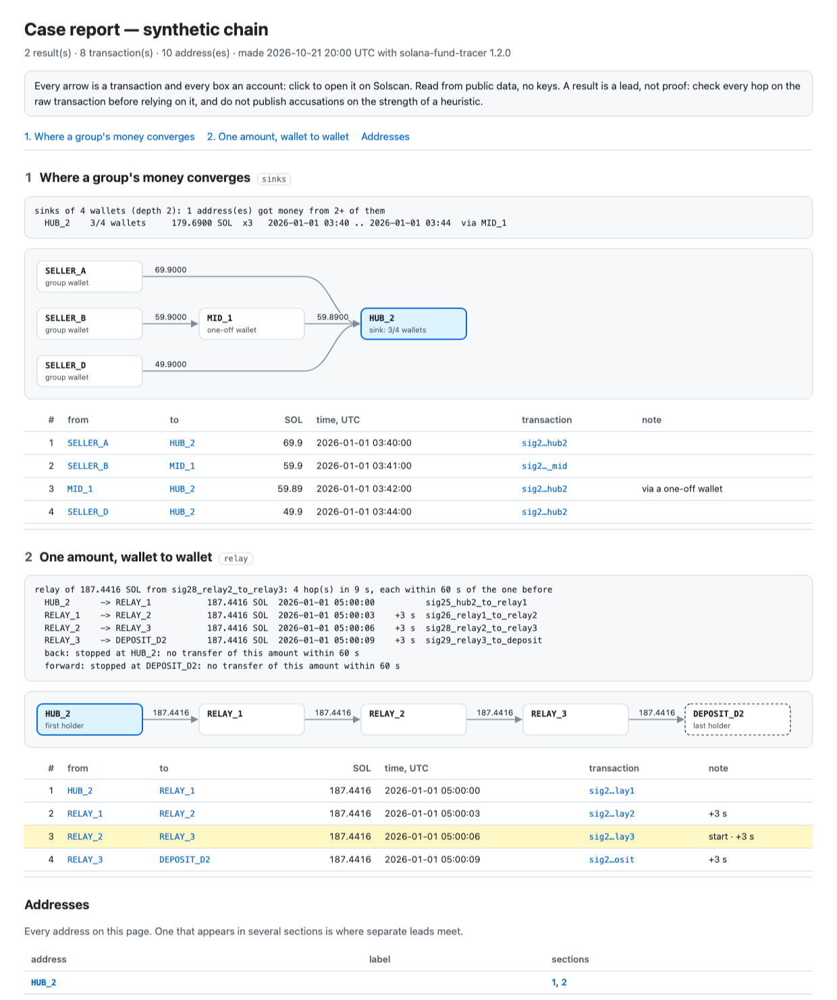

# solana-fund-tracer

[](LICENSE)    

Follow money on Solana: back to where it came from, forward to the exchange where it left, tell exchange deposit
addresses apart, catch one exact amount relayed through a chain of wallets in seconds, and put a whole case on one
HTML page with a link to every transaction. Read-only, standard library only, runs on the free public RPC.

<p align="center"></p>

## Commands

| Command | Question it answers |
|---|---|
| `back ADDR` | Where did this wallet's money come from? Follows the earliest incoming SOL transfer, hop by hop |
| `forward ADDR` | Where did it go? Follows the largest outgoing transfer (trades are not transfers) |
| `deposit ADDR …` | Is this an exchange deposit address? Looks for sweeps into a labelled exchange hot wallet |
| `funding ADDR --before SIG` | Who paid this wallet just before a given transaction (a large buy, a payment)? Flags memos |
| `sinks ADDR ADDR …` | Where does the money of a group converge? Addresses that received money from several of the wallets |
| `relay SIG` | Did one exact amount pass through a chain of wallets within seconds? Follows it both ways from one transfer (`relay ADDR --amount SOL` starts from an address) |
| `report FILE.json …` | One HTML page from saved `--json` output: a diagram of the transfers and a Solscan link for each. `--html PATH` before any command does the same for one run |
| `ledger ADDR` | The full history of an address as a JSONL ledger, oldest first. Resumable |
| `summary LEDGER` | Counterparties of a ledger: who sent how much, who received how much, which are exchanges |
| `stables ADDR` | USDC and USDT counterparties of an address, from its ledger |
| `labels` | Downloads exchange address labels into `labels.json` (see [Labels](#labels)) |
| `demo` | All of the above, offline, on a synthetic chain |

```bash
git clone https://github.com/hrekokovgmmek-lab/solana-fund-tracer && cd solana-fund-tracer
python3 -m fundtrace demo            # offline, nothing to install
python3 -m fundtrace labels          # once: exchange labels
python3 -m fundtrace back <wallet>
python3 -m fundtrace forward <wallet>
python3 -m fundtrace deposit <address> [<address> …]
python3 -m fundtrace sinks <wallet> <wallet> … --depth 2
python3 -m fundtrace relay <signature of one transfer>
python3 -m fundtrace --html case.html relay <wallet> --amount 187.4416
```

Every command prints text; add `--json` before the command for machine-readable output, or `--html case.html` for a
page with a diagram (see [Report](#report)).

## How it decides

- **Back: the earliest incoming transfer.** A fresh wallet is usually created and funded in one step. Its first
  incoming SOL transfer above 0.01 SOL is the funding; the account that lost that SOL is the funder.
- **Forward: the largest outgoing transfer.** Swaps are skipped: buying a token is not sending money to someone.
  Wrapped SOL is counted as SOL, so a transfer paid out of a WSOL account is not missed.
- **Stop at busy addresses.** An address with 50 or more transactions (`--busy`) is a service, an exchange or a hub.
  Its first funding says nothing about the money that passed through later, so the walk stops and says why:
  `exchange`, `busy address`, `loop` or `dead end`.
- **Deposit addresses by behaviour, not by name.** An exchange gives every customer a deposit address and sweeps it
  into a hot wallet. An address that sends SOL or tokens straight into a labelled exchange wallet is a deposit
  address. That is the point where on-chain tracing ends: who owns the account is known only to the exchange.
- **Where the money converges.** Funding is easy to disguise: a fresh wallet funded by an exchange withdrawal links
  to nothing. Where the profit goes afterwards is harder to hide, because the operator wants it back. `sinks` takes
  the wallets of a suspected group (say, everyone who sold a token in its first minutes) and lists the addresses that
  received money from at least two of them. `--depth 2` also follows one-off wallets in between: what a fresh
  intermediary forwards is credited to the wallet that paid it. Trades, transfers inside the group and token-account
  rent are not counted.
- **One amount, wallet to wallet.** A script that moves money through its own wallets forwards the whole sum at once,
  so the same non-round amount leaves each wallet seconds after it arrived. `relay` starts from one transfer and walks
  both ways: forward while the recipient sends the same amount on (± 0.001 SOL, `--tol`, so a fee taken on the way
  still matches) within 60 seconds (`--window`), back while the sender received it within 60 seconds before. It stops
  at an exchange label, a loop, or when nothing matches, and says which. A round amount is flagged: two transfers of
  10 SOL a minute apart can be chance, two of 187.4416 SOL hardly.
- **Busy wallets read from the right moment.** A hub can have thousands of transactions after the one you care about,
  and an address's history is served newest first. `before` accepts any transaction, not only one of that address, so
  `relay` takes a transaction from a block just after the window and reads the hub's history back from there:
  three requests (the newest page, one block, the page before it) instead of a walk through everything the hub did
  since.
- **Hidden payers.** `funding` flags transfers that carry a memo or are signed together with a one-off co-signer.
  Both are common ways to make "who paid whom" harder to read.
- **Read the whole history, not the explorer page.** `ledger` pages through every signature, keeps one line per
  transaction and can be stopped and resumed. `summary` and `stables` work on that file without the network.

Every number comes from balance changes in the transaction itself (SOL per account, tokens per owner), so it works
the same for any program.

## Real-world use

I used these methods on a coordinated group behind 16 PumpSwap pools, in which pool creation, migration and a
1,500–2,000 SOL "whale" buy landed in the same slot. Reading the full histories of the group's treasury (11.5k
transactions) and its root wallet (3.7k) showed where the money left: about 12,000 SOL to six Binance deposit
addresses and 542 SOL to Gate.io, each confirmed by sweeps into the exchanges' hot wallets, plus 105k USDT and
about $54k sent through the Rhino.fi and Mayan bridges to BSC, Base and Polygon. The bridge legs were followed by
hand in the bridges' explorers. The whole case took one day and about 18,500 requests to the public RPC.

`sinks` was later checked on the same case. Given the group's eight "whale" wallets (30 latest transactions each,
one hop, about 130 calls to the public RPC), it returned exactly one address that received money from three of
them: 3,985 SOL in 5 transfers. It was the same hub found earlier by hand.

`relay` was checked on the same case too. Started from either of two transfers, it rebuilt the chain found earlier by
hand: one non-round amount went from a token creator's wallet through one of the group's hubs to another creator's
wallet in 9 seconds. The hub had more than 10,000 later transactions; reading it from a block just after the window,
the whole walk took 8–10 requests to the public RPC. On a second chain, started from one transfer in the middle, it
found all five hops: a round sum left a hub, passed four wallets with two transactions each and reached the group's
treasury 14 seconds later, the same path as found by hand.

## Report

`--html case.html` before any command writes its result as one page; `report` puts several saved results together:

```bash
python3 -m fundtrace --json sinks <wallet> <wallet> … --depth 2 > sinks.json
python3 -m fundtrace --json relay <signature> > relay.json
python3 -m fundtrace report sinks.json relay.json -o case.html --title "Case 1"
```

Each section shows the command's text output, a diagram of the transfers (one arrow per sender and recipient, the
sum on it) and a table with the time of every transfer. Every arrow, box and table row links to the transaction or the
account on Solscan. Addresses that turn up in several sections are listed at the end: that is where separate leads
meet. The page is a single file with no scripts and nothing loaded from the network, so it opens offline and can be
attached as it is. `python3 -m fundtrace --html demo.html demo` builds one from the synthetic chain.

<p align="center"></p>

## Labels

The tracer stops at labelled exchange wallets, and a deposit address is one that sweeps into such a wallet.
Labels are **not** included in this repository. `python3 -m fundtrace labels` downloads the open
[Dune Spellbook](https://github.com/duneanalytics/spellbook) list of Solana exchange addresses into `labels.json`.
That list is published under the Business Source License 1.1, so check its terms before you build a product on it.
You can add your own labels to the same file: `{"<address>": {"cex": "Exchange", "name": "Exchange hot wallet 1"}}`.

## Configuration

| Variable / flag | Default | |
|---|---|---|
| `FUNDTRACE_RPC_URL` / `--rpc` | `https://api.mainnet-beta.solana.com` | Any Solana JSON-RPC endpoint |
| `FUNDTRACE_RPS` / `--rps` | `1` | Requests per second, **shared by all running processes** (a lock file in the cache) |
| `FUNDTRACE_CACHE` / `--cache` | `.fundtrace/cache` | Every answer is cached, so a second run costs no requests |
| `--fresh` | off | Re-read signature lists (new transactions); transactions themselves never change |
| `--labels` | `labels.json` | Exchange labels |

Some Python builds have no root certificates; requests then fall back to `curl` automatically.

## Limits

- The rules are heuristics. Splitting money across many wallets, mixing it with other people's funds or routing it
  through a busy service breaks a simple chain. The tracer stops and says so; it does not guess.
- Labels are only as complete as the list you load. An unlabelled exchange wallet looks like a busy address.
- Bridges end the trail on Solana. Follow the other chain in the bridge's own explorer.
- The public RPC keeps a limited history and may not return the start of a very busy address.
- `relay` follows SOL (wrapped SOL included), not tokens, and only a sum passed on whole: split into several
  transfers or swapped on the way, it stops. Each wallet's transactions inside the window are read nearest first, at
  most 30 of them (`--reads`, every one is a request); a busier wallet ends the walk as `busy address`. A relay hop
  comes seconds after the money arrived, so it is among the first read.

## Responsible use

The tool reads public data and holds no keys. It finds paths of money, not people. A result is a lead: check every
hop on the raw transactions before you rely on it, and do not publish accusations against an address on the
strength of a heuristic. The HTML report is a local file that lists addresses and links; share it like any other
case notes.

## Tests

```bash
python3 -m unittest discover -s tests
```

51 tests on a synthetic chain served by a fake RPC node: the walks, loops and busy addresses, deposit sweeps, memo
flags, convergence of a group's money (direct, through one-off wallets, with a time cut, wrapped SOL credited to the
owner), relays (both directions, the time window, the tolerance, loops, a transfer the wallet only co-signed, a busy
wallet read back from a later block, the cap on reads), the report (edges, Solscan links, cycles, escaping, the CLI), the resumable
ledger, stablecoin flows, the cache, retries on rate limits and the shared rate limit. Each of 17 deliberate bugs put
into the new code was caught by at least one test.

## License

MIT. Exchange labels downloaded with `fundtrace labels` keep their own license (see [Labels](#labels)).
