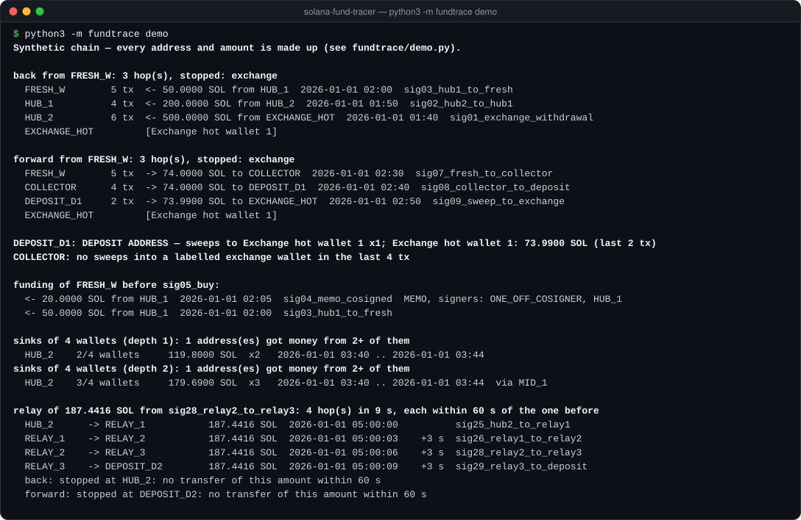

# solana-fund-tracer

[](LICENSE)    

Follow money on Solana: back to where it came from, forward to the exchange where it left, and tell exchange
deposit addresses apart. Read-only, standard library only, runs on the free public RPC.

<p align="center"></p>

## Commands

| Command | Question it answers |
|---|---|
| `back ADDR` | Where did this wallet's money come from? Follows the earliest incoming SOL transfer, hop by hop |
| `forward ADDR` | Where did it go? Follows the largest outgoing transfer (trades are not transfers) |
| `deposit ADDR …` | Is this an exchange deposit address? Looks for sweeps into a labelled exchange hot wallet |
| `funding ADDR --before SIG` | Who paid this wallet just before a given transaction (a large buy, a payment)? Flags memos |
| `sinks ADDR ADDR …` | Where does the money of a group converge? Addresses that received money from several of the wallets |
| `ledger ADDR` | The full history of an address as a JSONL ledger, oldest first. Resumable |
| `summary LEDGER` | Counterparties of a ledger: who sent how much, who received how much, which are exchanges |
| `stables ADDR` | USDC and USDT counterparties of an address, from its ledger |
| `labels` | Downloads exchange address labels into `labels.json` (see [Labels](#labels)) |
| `demo` | All of the above, offline, on a synthetic chain |

```bash
git clone https://github.com/hrekokovgmmek-lab/solana-fund-tracer && cd solana-fund-tracer
python3 -m fundtrace demo            # offline, nothing to install
python3 -m fundtrace labels          # once: exchange labels
python3 -m fundtrace back <wallet>
python3 -m fundtrace forward <wallet>
python3 -m fundtrace deposit <address> [<address> …]
python3 -m fundtrace sinks <wallet> <wallet> … --depth 2
```

Every command prints text; add `--json` before the command for machine-readable output.

## How it decides

- **Back: the earliest incoming transfer.** A fresh wallet is usually created and funded in one step. Its first
  incoming SOL transfer above 0.01 SOL is the funding; the account that lost that SOL is the funder.
- **Forward: the largest outgoing transfer.** Swaps are skipped: buying a token is not sending money to someone.
  Wrapped SOL is counted as SOL, so a transfer paid out of a WSOL account is not missed.
- **Stop at busy addresses.** An address with 50 or more transactions (`--busy`) is a service, an exchange or a hub.
  Its first funding says nothing about the money that passed through later, so the walk stops and says why:
  `exchange`, `busy address`, `loop` or `dead end`.
- **Deposit addresses by behaviour, not by name.** An exchange gives every customer a deposit address and sweeps it
  into a hot wallet. An address that sends SOL or tokens straight into a labelled exchange wallet is a deposit
  address. That is the point where on-chain tracing ends: who owns the account is known only to the exchange.
- **Where the money converges.** Funding is easy to disguise: a fresh wallet funded by an exchange withdrawal links
  to nothing. Where the profit goes afterwards is harder to hide, because the operator wants it back. `sinks` takes
  the wallets of a suspected group (say, everyone who sold a token in its first minutes) and lists the addresses that
  received money from at least two of them. `--depth 2` also follows one-off wallets in between: what a fresh
  intermediary forwards is credited to the wallet that paid it. Trades, transfers inside the group and token-account
  rent are not counted.
- **Hidden payers.** `funding` flags transfers that carry a memo or are signed together with a one-off co-signer.
  Both are common ways to make "who paid whom" harder to read.
- **Read the whole history, not the explorer page.** `ledger` pages through every signature, keeps one line per
  transaction and can be stopped and resumed. `summary` and `stables` work on that file without the network.

Every number comes from balance changes in the transaction itself (SOL per account, tokens per owner), so it works
the same for any program.

## Real-world use

I used these methods on a coordinated group behind 16 PumpSwap pools, in which pool creation, migration and a
1,500–2,000 SOL "whale" buy landed in the same slot. Reading the full histories of the group's treasury (11.5k
transactions) and its root wallet (3.7k) showed where the money left: about 12,000 SOL to six Binance deposit
addresses and 542 SOL to Gate.io, each confirmed by sweeps into the exchanges' hot wallets, plus 105k USDT and
about $54k sent through the Rhino.fi and Mayan bridges to BSC, Base and Polygon. The bridge legs were followed by
hand in the bridges' explorers. The whole case took one day and about 18,500 requests to the public RPC.

`sinks` was later checked on the same case. Given the group's eight "whale" wallets (30 latest transactions each,
one hop, about 130 calls to the public RPC), it returned exactly one address that received money from three of
them: 3,985 SOL in 5 transfers. It was the same hub found earlier by hand.

## Labels

The tracer stops at labelled exchange wallets, and a deposit address is one that sweeps into such a wallet.
Labels are **not** included in this repository. `python3 -m fundtrace labels` downloads the open
[Dune Spellbook](https://github.com/duneanalytics/spellbook) list of Solana exchange addresses into `labels.json`.
That list is published under the Business Source License 1.1, so check its terms before you build a product on it.
You can add your own labels to the same file: `{"<address>": {"cex": "Exchange", "name": "Exchange hot wallet 1"}}`.

## Configuration

| Variable / flag | Default | |
|---|---|---|
| `FUNDTRACE_RPC_URL` / `--rpc` | `https://api.mainnet-beta.solana.com` | Any Solana JSON-RPC endpoint |
| `FUNDTRACE_RPS` / `--rps` | `1` | Requests per second, **shared by all running processes** (a lock file in the cache) |
| `FUNDTRACE_CACHE` / `--cache` | `.fundtrace/cache` | Every answer is cached, so a second run costs no requests |
| `--fresh` | off | Re-read signature lists (new transactions); transactions themselves never change |
| `--labels` | `labels.json` | Exchange labels |

Some Python builds have no root certificates; requests then fall back to `curl` automatically.

## Limits

- The rules are heuristics. Splitting money across many wallets, mixing it with other people's funds or routing it
  through a busy service breaks a simple chain. The tracer stops and says so; it does not guess.
- Labels are only as complete as the list you load. An unlabelled exchange wallet looks like a busy address.
- Bridges end the trail on Solana. Follow the other chain in the bridge's own explorer.
- The public RPC keeps a limited history and may not return the start of a very busy address.

## Responsible use

The tool reads public data and holds no keys. It finds paths of money, not people. A result is a lead: check every
hop on the raw transactions before you rely on it, and do not publish accusations against an address on the
strength of a heuristic.

## Tests

```bash
python3 -m unittest discover -s tests
```

29 tests on a synthetic chain served by a fake RPC node: the walks, loops and busy addresses, deposit sweeps, memo
flags, convergence of a group's money (direct, through one-off wallets, with a time cut, wrapped SOL credited to the
owner), the resumable ledger, stablecoin flows, the cache, retries on rate limits and the shared rate limit.

## License

MIT. Exchange labels downloaded with `fundtrace labels` keep their own license (see [Labels](#labels)).
